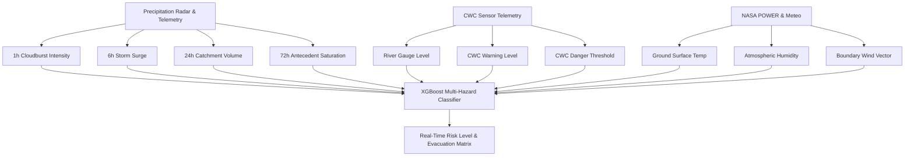

# 🌊 AapdaSetu Machine Learning Architecture & Model Training

This document provides a comprehensive overview of the **AapdaSetu AI Disaster & Multi-Hazard Prediction Engine**, its dataset features, mathematical grounding in hydrological physics, and instructions for training and evaluating the models.

---

## 📌 1. Overview of AI Models

AapdaSetu deploys an ensemble of gradient-boosted decision trees (**XGBoost 3.x**) optimized for extreme hydrological non-linearities and terrain geotechnical dynamics:

| Model | Target Hazard | Objective | Classes | Primary Signals | Validation Accuracy |
| :--- | :--- | :--- | :--- | :--- | :--- |
| **Model 1: Riverine Flood Classifier** | River Basin Inundation | Early 72-Hour catchment warning | 3 Classes: `0: LOW`, `1: MEDIUM`, `2: HIGH` | 72h/24h Rainfall, River Level, CWC Warning/Danger Gauges | **96.30%** |
| **Model 2: Flash Flood / Cloudburst Classifier** | Rapid Mountain & Urban Flash Floods | Cloudburst rapid response (<15 min) | 4 Classes: `0: LOW`, `1: MOD`, `2: HIGH`, `3: CRITICAL` | 1h Cloudburst Intensity, Soil Saturation, 24h Forecast | **99.28%** |
| **Model 3: Landslide Slope Stability Classifier** | Geological Mountain Failures | Geotechnical mass movement prediction | 4 Classes: `0: LOW`, `1: MOD`, `2: HIGH`, `3: CRITICAL` | Slope Angle (°), Geotechnical Factor, 72h Rain Infiltration | **98.99%** |

---

## 🧠 2. Feature Engineering & Hydrological Domain Grounding

Standard generic weather models fail during flash floods and cloudbursts because they do not model antecedent soil saturation curves. AapdaSetu models the following 10 domain features:



1. **`rainfall_1h` (mm)**: Detects sudden convective cloudbursts (>50 mm/h threshold).
2. **`rainfall_6h` (mm)**: Measures short-term local storm accumulation.
3. **`rainfall_24h` (mm)**: Captures total sub-basin catchment drainage.
4. **`rainfall_72h` (mm)**: Antecedent precipitation index (API) representing total soil saturation.
5. **`river_level` (m)**: Real-time river gauge height reported by CWC telemetry.
6. **`danger_level` (m)**: Official CWC Danger Mark where water enters human habitats.
7. **`warning_level` (m)**: Official CWC Alert Level where emergency teams are placed on standby.
8. **`temperature` (°C)**: Thermal driver for convective atmospheric updrafts.
9. **`humidity` (%)**: Vapor pressure indicator for moisture convergence.
10. **`wind_speed` (km/h)**: Storm vector acceleration.

---

## 🚀 3. How to Run Model Training (Demonstration)

To train and evaluate all models from scratch with full classification reports and live inference demo:

```bash
# Activate your python environment
python train_model.py
```

### Expected Output
- **Stage 1**: Loads `training_data.csv` (1,620 rows) and `data/multi_hazard_training_data.csv` (3,475 rows).
- **Stage 2**: Trains **Model 1 (XGBoost Flood)** with an 80/20 Stratified Split -> prints Accuracy (96.3%), Confusion Matrix, and Feature Importance bar chart.
- **Stage 3**: Trains **Model 2 (Flash Flood)** -> prints Accuracy (99.28%).
- **Stage 4**: Trains **Model 3 (Landslide)** -> prints Accuracy (98.99%).
- **Stage 5**: Serializes models to `models/` and `backend/`.
- **Stage 6**: Runs 3 live test scenarios (Varanasi normal, Assam monsoon, Chamoli cloudburst) with probability distributions.

---

## 📊 4. Model Artifacts

Trained model weights and configurations are serialized in JSON format:
- `models/xgboost_flood_model.json`
- `models/xgboost_flash_flood_model.json`
- `models/xgboost_landslide_model.json`
- `backend/xgboost_flood_model.json` (mirrored for live FastAPI runtime inference)
